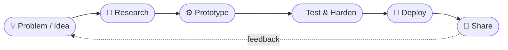

<!-- ═══════════════════════ HERO ═══════════════════════ -->
<div align="center">



<a href="https://github.com/RatneshPathak">
  
</a>

<br/>

<a href="https://linkedin.com/in/ratnesh-pathak-087466279"></a>
<a href="https://leetcode.com/u/YxCXLC7VPk/"></a>
<a href="mailto:pathakratnesh03@gmail.com"></a>
<a href="https://instagram.com/ratnesh_0318"></a>

<br/><br/>


<br/>

<a href="https://github.com/RatneshPathak?tab=achievements"></a>
<a href="https://github.com/RatneshPathak?tab=repositories"></a>


</div>

<br/>

<!-- ═══════════════════════ HIGHLIGHTS ═══════════════════════ -->
## 🌟 Highlight Reel

<div align="center">

<table>
<tr>
<td align="center" width="14%">🎓<br/><b>9.36</b><br/><sub>SGPA</sub></td>
<td align="center" width="14%">📖<br/><b>3</b><br/><sub>Research Papers</sub></td>
<td align="center" width="14%">💼<br/><b>13,100+</b><br/><sub>LinkedIn Followers</sub></td>
<td align="center" width="14%">📚<br/><b>110+</b><br/><sub>Certifications</sub></td>
<td align="center" width="14%">🏅<br/><b>150/150</b><br/><sub>PG Final Project</sub></td>
<td align="center" width="14%">🧩<br/><b>25</b><br/><sub>LeetCode Badges</sub></td>
<td align="center" width="14%">🚀<br/><b>2×</b><br/><sub>Hackathon Finalist</sub></td>
</tr>
<tr>
<td align="center">🌐<br/><b>8</b><br/><sub>Live Projects</sub></td>
<td align="center">🏆<br/><b>3×</b><br/><sub>National-Level</sub></td>
<td align="center">🥇<br/><b>3×</b><br/><sub>State-Level</sub></td>
<td align="center">💼<br/><b>6</b><br/><sub>Internships</sub></td>
<td align="center">🌟<br/><b>Gold</b><br/><sub>LetsUpgrade Milestone</sub></td>
<td align="center">🎪<br/><b>300+</b><br/><sub>Tech Events Attended</sub></td>
<td align="center">🏆<br/><b>60+</b><br/><sub>Inter-collegiate Wins</sub></td>
</tr>
<tr>
<td align="center">📦<br/><b>62</b><br/><sub>GitHub Repositories</sub></td>
<td align="center">⭐<br/><b>37</b><br/><sub>Repos Starred</sub></td>
<td align="center">🎖️<br/><b>3</b><br/><sub>GitHub Achievements</sub></td>
<td align="center">🟩<br/><b>340+</b><br/><sub>Contributions (past year)</sub></td>
<td align="center">🔥<br/><b>200</b><br/><sub>LeetCode Current Streak</sub></td>
<td align="center">📅<br/><b>500+</b><br/><sub>LeetCode Active Days</sub></td>
<td align="center">🌐<br/><b>33+</b><br/><sub>Public Showcase Repos</sub></td>
</tr>
</table>

<br/>

🏛️ <b>Permanently featured on UG & PG college websites, official banners, and college magazines — recognized as a standout student across both institutions.</b>

</div>

---

## 👋 About Me

<table>
<tr>
<td width="62%" valign="top">

```text
┌──────────────────────────────────────────────────────┐
│  $ whoami                                            │
├──────────────────────────────────────────────────────┤
│  name        : Ratnesh Pathak                        │
│  education   : M.Sc. Information Technology          │
│                (9.36 SGPA · Batch Topper)            │
│  role        : AI/ML Intern @ Alvin IT Solutions     │
│  location    : Mumbai, India                         │
│  focus       : AI • Machine Learning • Data Analytics│
│  building    : Practical, verifiable AI/software     │
│  practicing  : Python • SQL • Power BI • CV          │
│  exploring   : AI Agents • APIs • NLP                │
│  mindset     : Learn → Build → Share → Improve       │
└──────────────────────────────────────────────────────┘
```

</td>
<td width="38%" align="center" valign="middle">


</td>
</tr>
</table>

I'm an **M.Sc. IT graduate (9.36 SGPA, batch topper)** working as an **AI/ML Intern at Alvin IT Solutions** in Mumbai. My work sits at the intersection of **applied machine learning, data analytics, NLP, and full-stack development** — I like taking a problem from research and idea to a working prototype.

I've **published 3 research papers** (including financial sentiment analysis with NLP), scored **150/150** on my final research project exam, and been permanently featured on my UG and PG college's official websites, banners, and magazines. Alongside that, I stay active on LeetCode, take on freelance/client work, and stay close to Mumbai's tech ecosystem through events and community involvement.

### 🔁 How I Work



### 🎯 Currently

| | |
|---|---|
| 🔭 **Working on** | AI/ML internship projects at Alvin IT Solutions |
| 🌱 **Exploring** | AI Agents · APIs · NLP |
| 🧩 **Practicing** | LeetCode · Python · SQL · Power BI · Computer Vision |
| 🤝 **Looking for** | AI/ML opportunities, collaborations & interesting problems |

---

## 🛠️ Tech Stack

<div align="center">

**Languages**

<br/>

**AI / ML & Data**

<br/>

**Frameworks & Libraries**

<br/>

**Databases**

<br/>

**DevOps, Testing & Tools**

<br/>

**Also**


</div>

---

## 🚀 Featured Projects

<div align="center">


<sub>🌐 Every project links to a public showcase with screenshots and documentation. Source code is private and available on request.</sub>

</div>

### 🆕 Latest Builds

<table>
<tr>
<td width="33%" valign="top">

#### 🎓 Education Hub
<sub>🆕 **NEW** · Full-Stack Learning Platform</sub>

A Django web app for discovering colleges, with search, stream/city filters, reviews, and user authentication.

- 🔍 College search and stream/city filters
- 🔐 Registration, login & password reset
- ⭐ Reviews, food & sightseeing by city
- 🗄️ SQLite database + Django admin


🌐 Showcase (source private) · **[Repository](https://github.com/RatneshPathak/Education-Hub-Showcase)**

</td>
<td width="33%" valign="top">

#### 🐾 Pet Adoption System
<sub>🆕 **NEW** · Animal Welfare Platform</sub>

A PHP-based platform connecting pets in need with adopters.

- 🐶 Pet listings & profiles, galleries, and feedback & contact forms
- 🗄️ Relational SQL database (XAMPP stack)


🌐 Showcase (source private) · **[Repository](https://github.com/RatneshPathak/Pet-Adoption-System-Showcase)**

</td>
<td width="33%" valign="top">

#### 🎟️ Event Hub
<sub>🆕 **NEW** · Event Management System</sub>

A JSP and Servlet-based event management system built on the Java web stack.

- ☕ Java Servlets + JSP
- 🗄️ MySQL database integration
- 📦 Maven-managed build


🌐 Showcase (source private) · **[Repository](https://github.com/RatneshPathak/Event-Hub-Showcase)**

</td>
</tr>
</table>

### 🧠 AI / ML & Intelligence Platforms

<table>
<tr>
<td width="50%" valign="top">

#### 💹 FinSentAI
<sub>Financial Intelligence Platform</sub>

End-to-end platform combining NLP, machine learning, financial news, market data, and actionable signal generation.

- 🧠 TF-IDF + SVM sentiment, VADER + ensemble prediction
- 📶 BUY / SELL / HOLD / WATCH / CAUTION signal engine
- 🔐 REST API with API-key auth, user auth & roles
- 📊 Watchlists, alerts, dashboards, AI assistant, report builder
- 🐳 Docker + Gunicorn, Pytest suite, GitHub Actions CI


🌐 Showcase (source private) · **[Repo](https://github.com/RatneshPathak/finsentai-showcase)** · 🚀 **[Live Demo](https://finsentai.onrender.com/)**

</td>
<td width="50%" valign="top">

#### 🛡️ ContractGuard Pro
<sub>AI Contract Intelligence Platform</sub>

Reviews contracts, flags risk, explains clauses, generates redlines, and chats about contracts.

- 🤖 AI analysis with Groq LLMs
- 📄 PDF and DOCX extraction
- ⚠️ Risk & clause analysis, redlines, summaries
- 🔒 Helmet headers, rate limiting, strict CORS
- 🌱 Env-based API keys, feature-branch Git workflow


🌐 Showcase (source private) · **[Repository](https://github.com/RatneshPathak/contractguard-pro-showcase)**

</td>
</tr>
<tr>
<td width="50%" valign="top">

#### 🎣 PhishGuard
<sub>Real-Time Phishing URL Detection</sub>

ML-driven security platform with feature extraction, classification, risk scoring, and explainable insights.

- 🔍 Real-time detection with a trained ML model
- 📊 Risk categories, safety scores, visual analytics
- 🗄️ Scan history and database-backed workflows
- 🧪 Dataset prep, training, evaluation & inference pipeline


🌐 Showcase (source private) · **[Repo](https://github.com/RatneshPathak/phishguard-showcase)** · 🚀 **[Live Demo](https://phishguard-zw3p.onrender.com/)**

</td>
<td width="50%" valign="top">

#### 📊 WagesOfMumbai-Observatory
<sub>Digital Wage & Insecurity Observatory</sub>

Tracks income insecurity among women in Mumbai's informal economy, combining field research with computational policy analysis.

- 📊 Multi-factor Vulnerability Index (VI)
- 🗺️ Ward-level geospatial heatmaps
- 🏛️ Policy Matcher for Government Social Security Schemes
- ☁️ Deployed on Render (Gunicorn)


🌐 Showcase (source private) · **[Repo](https://github.com/RatneshPathak/WagesOfMumbai-Observatory-Showcase)** · 🚀 **[Live Demo](https://wagesofmumbai-observatory.onrender.com/)**

</td>
</tr>
</table>

<details>
<summary><b>🌐 Full-Stack Applications</b> &nbsp;·&nbsp; <sub>click to expand</sub></summary>
<br/>

<table>
<tr>
<td width="50%" valign="top">

#### ✈️ WanderLust
<sub>AI-Powered Travel Super App</sub>

Intelligent trip planning, travel utilities, dashboards, budgets, and booking workflows.

- 🔐 Auth, trip management & admin panel
- 💰 Budgets, activities, analytics
- 🌦️ Weather, ✈️ flight, 📍 geocoding, 💱 currency APIs
- 🤝 Shared trips + 🧠 AI travel assistance
- 🧳 28+ features: smart packing, voice assistant, QR sharing, pilgrimage experiences, GPS


🌐 Showcase (source private) · **[Repo](https://github.com/RatneshPathak/WanderLust-Showcase)** · 🚀 **[Live Demo](https://wander-lust-beta-eight.vercel.app/)**

</td>
<td width="50%" valign="top">

#### 🗳️ MyVotingApp
<sub>Maharashtra General Assembly · Secure Online Voting System</sub>

Flask + React e-voting platform with admin-approved voters, one-vote enforcement, live results, and automated vote receipts.

- 🔐 PBKDF2 hashing, CSRF tokens on state-changing requests
- 🧾 Admin dashboard: voter approval, candidates, CSV export
- ✅ Server-side vote locking · structured validation
- 🧾 JWT authentication, role-based access, automated vote receipts
- ⏱️ Session timeout, HttpOnly/SameSite cookies


🌐 Showcase (source private) · **[Repo](https://github.com/RatneshPathak/MyVotingApp-Showcase)** · 🚀 **[Live Demo](https://myvotingapp-obic.onrender.com/)**

</td>
</tr>
<tr>
<td width="50%" valign="top">

#### 📚 E-Book Management System
<sub>Java Full-Stack Web Application</sub>

E-book platform with authentication, administration, purchasing, inventory, and search.

- 🔐 Role-based access
- 👨‍💼 Admin dashboard & inventory
- 💳 Cart, checkout and orders (demo orders only, no real payments)
- 🗄️ MySQL integration


🌐 Showcase (source private) · **[Repo](https://github.com/RatneshPathak/eBook-Management-System-Showcase)** · 🚀 **[Live Demo](https://ebook-management-system-demo.onrender.com/)**

</td>
<td width="50%" valign="top">

#### 😊 Mood Journal
<sub>Personal Mood Tracking & Reflection</sub>

A private, calming React journal; all data stays in the browser, no backend or account needed.

- 📊 Dashboard, streaks, reflection prompts, trends
- 📝 Create/edit/delete, search, filter, sort, paginate
- 📈 7/30/90-day insights
- 🌗 Light/dark themes · 💾 JSON export/import
- 🛡️ Resilient storage, accessible & responsive


🌐 Showcase (source private) · **[Repository](https://github.com/RatneshPathak/Mood-Journal-Showcase)**

</td>
</tr>
<tr>
<td width="50%" valign="top">

#### 🎵 Ratnesh's Music
<sub>Spotify-Inspired Music App</sub>

React music app with Spotify authentication, liked songs, favorite artists, and a responsive player UI.

- 🎧 Spotify Authorization Code with PKCE
- ❤️ Liked songs & 🎤 favorite artists from your account
- ▶️ Playback bar, profile & avatar
- 🛡️ Token expiration and playback error handling


🌐 Showcase (source private) · **[Repository](https://github.com/RatneshPathak/Spotify-Clone-showcase)**

</td>
<td width="50%" valign="top">

#### 🎬 Netflix Homepage
<sub>Frontend UI Project</sub>

Netflix-inspired homepage showcasing frontend development and modern deployment.

- 🎥 Landing page, trending sections
- 💳 Subscription plans · ❓ FAQ
- ☁️ Deployed with Vercel


🌐 Showcase (source private) · **[Repo](https://github.com/RatneshPathak/Netflix-UI-Showcase)** · 🌐 **[Live Demo](https://ratneshnetflixhomepage.vercel.app/)**

</td>
</tr>
</table>

</details>

<details>
<summary><b>🤖 Automation, Analytics & Practice</b> &nbsp;·&nbsp; <sub>click to expand</sub></summary>
<br/>

<table>
<tr>
<td width="50%" valign="top">

#### 🤖 RPA Automation
<sub>Automated Data Entry System</sub>

Removes repetitive manual entry with a web interface, Excel processing, and UiPath workflows.

- ⚙️ UiPath reads Excel and fills web forms
- 🛡️ Error handling for reliable runs
- ✅ 100% accuracy in the demonstrated workflow


🌐 Showcase with demo videos (source private) · **[Repository](https://github.com/RatneshPathak/RPA-Automated-Data-Entry-Showcase)**

</td>
<td width="50%" valign="top">

#### 👁️ crowd_safety_ai
<sub>Computer Vision for Public Safety</sub>

Real-time crowd risk detection analyzing crowd density and motion anomalies.


🌐 Public · **[Repository](https://github.com/RatneshPathak/crowd_safety_ai)**

</td>
</tr>
<tr>
<td width="50%" valign="top">

#### 📊 Power-BI-dashboard
<sub>Data Analytics</sub>

Turns data into interactive business insights.


🌐 Public · **[Repository](https://github.com/RatneshPathak/Power-BI-dashboard)**

</td>
<td width="50%" valign="top">

#### 📓 IIT-BOMBAY- &nbsp;·&nbsp; 🐍 Python-Practice
<sub>Notebooks & Problem Solving</sub>

Notebook-based learning work and applied Python practice.


🌐 **[IIT-BOMBAY-](https://github.com/RatneshPathak/IIT-BOMBAY-)** · **[Python-Practice](https://github.com/RatneshPathak/Python-Practice)** · **[Algo-Solutions](https://github.com/RatneshPathak/Algo-Solutions)** · **[CLOUDINTEL-Team-Ignites](https://github.com/RatneshPathak/CLOUDINTEL-Team-Ignites)** · **[Travels](https://github.com/RatneshPathak/Travels)**

</td>
</tr>
</table>

</details>

<details>
<summary><b>📦 Earlier Projects & Experiments</b> &nbsp;·&nbsp; <sub>click to expand</sub></summary>
<br/>

<table>
<tr>
<td width="50%" valign="top">

#### 🧠 RAG-Powered Intelligent Chatbot
<sub>Retrieval-Augmented Generation</sub>

Answers questions from custom datasets by retrieving context from a vector database before generating with an LLM, which reduces hallucinations.

- 🔗 Full RAG pipeline: loading, chunking, embeddings, semantic search
- 🤖 Multiple LLMs via LangChain, compared on output quality
- 🎯 Tuned chunking and embedding models for retrieval accuracy
- 💬 Chat interface inside VS Code with Jupyter


🌐 Public · **[Repository](https://github.com/RatneshPathak/RAG-Chatbot)**

</td>
<td width="50%" valign="top">

#### ☁️ Cloud-Based Sentiment Analysis Pipeline
<sub>Financial Research on Google Colab</sub>

A reproducible, cloud-native pipeline for financial sentiment, with batch processing of large datasets and real-time CLI classification.

- 📦 Batch mode + interactive classification
- 🔁 Shareable notebook, no local setup needed
- 🧪 Easy experiments across datasets, parameters and preprocessing


🌐 Public · **[Repository](https://github.com/RatneshPathak/Financial-Sentiment-Colab-Pipeline)**

</td>
</tr>
<tr>
<td width="50%" valign="top">

#### 📰 Real-Time Financial Sentiment Web App
<sub>Research → Web App</sub>

Turns my published IJSDR paper, *"Sentiment Analysis of Financial News Data Using Machine Learning Techniques"*, into a working web app.

- ⚡ Instant Positive / Negative / Neutral classification of headlines
- 🌐 Flask REST backend with a responsive UI
- 🧪 Trained model from the paper deployed to production


🌐 Showcase (source private) · **[Repository](https://github.com/RatneshPathak/Financial-Sentiment-Web-App-Showcase)**

</td>
<td width="50%" valign="top">

#### 📈 Financial Market Sentiment Intelligence Dashboard
<sub>Power BI · 1M+ Headlines</sub>

Sentiment patterns across more than a million financial news headlines, with time-series and keyword trend analysis.

- 📉 Sentiment volatility and market-mood transitions
- 🔑 Keyword frequency analysis for sentiment catalysts
- 🔎 Drill-down dashboards, DAX measures, ETL and data modeling


🌐 Public · **[Repository](https://github.com/RatneshPathak/Financial-Sentiment-PowerBI)**

</td>
</tr>
<tr>
<td width="50%" valign="top">

#### ✅ Task Management Web App
<sub>Flask CRUD</sub>

To-do app to add, edit and track daily tasks, with persistence handled in Flask.


🌐 Showcase (source private) · **[Repository](https://github.com/RatneshPathak/Task-Management-Showcase)**

</td>
<td width="50%" valign="top">

#### 💬 Interactive AI Chat Bot
<sub>NLP Conversational Agent</sub>

Web-based chatbot that interprets user queries with NLP and replies through a responsive chat UI.

- 🗣️ NLP-based query understanding
- 🌐 Flask front-end + back-end


🌐 Showcase (source private) · **[Repository](https://github.com/RatneshPathak/AI-Chatbot-Showcase)**

</td>
</tr>
<tr>
<td width="50%" valign="top">

#### 🌦️ Real-Time Weather Forecasting App
<sub>API Integration</sub>

Live weather and forecasts for any location.

- 🔌 Third-party weather API integration
- ⚡ Async JavaScript updates, no page reloads
- 🪶 Lightweight Flask backend


🌐 Showcase (source private) · **[Repository](https://github.com/RatneshPathak/Weather-Forecast-App-Showcase)**

</td>
<td width="50%" valign="top">

#### 🔳 Advanced QR Code Generator
<sub>Full-Stack Utility</sub>

Turns text, URLs and contact info into customizable QR codes.

- 🎨 Color, size and format options
- 👀 Real-time preview + instant download
- 🛡️ Validated Flask backend


🌐 Showcase (source private) · **[Repository](https://github.com/RatneshPathak/QR-Code-Generator-Showcase)**

</td>
</tr>
<tr>
<td width="50%" valign="top">

#### 🔑 Password Strength Analyzer
<sub>Client-Side Security Tool</sub>

Real-time strength scoring with visual feedback and improvement tips, all in the browser for privacy.

- 🌈 Color gradients, progress bars, security scores
- 📚 Explains common vulnerabilities and best practices


🌐 Showcase (source private) · **[Repository](https://github.com/RatneshPathak/Password-Strength-Analyzer-Showcase)**

</td>
<td width="50%" valign="top">

#### 🌐 Personal Portfolio
<sub>Responsive SPA · Mobile-First</sub>

Project gallery, publications section, certifications and a contact form, deployed on Vercel.


🌐 Showcase (source private) · **[Repository](https://github.com/RatneshPathak/Portfolio-Showcase)** · 🌐 **[Live Site](https://ratneshpathakportfolio.vercel.app/)**

</td>
</tr>
</table>

</details>

---

## 🏅 Achievements

<table>
<tr>
<td width="33%" valign="top">

### 🎓 Academic
- M.Sc. IT — **9.36 SGPA** (Batch Topper)
- **150/150** in Final Research Project Exam
- **3** published research papers

### 🏛️ Recognition
- Permanently featured on UG & PG college websites, official banners, and college magazines

</td>
<td width="33%" valign="top">

### 🏆 Competitions
- **3×** national-level
- **3×** state-level
- **60+** inter-collegiate wins
- **20** individual trophies · **20+** medals

### 🚀 Hackathons
- **2× Finalist**

</td>
<td width="33%" valign="top">

### 💼 Professional
- Best Student of Batch — **JP Morgan × Anudip Foundation** (Gold Milestone)
- **110+** certifications
- **6** internships

### 🌐 Community & Leadership
- Student Council Member · Documentation Head
- Event Organizer · Head Core (Freshers & Farewell)
- Student Coordinator, ONGC-NIO · Contingent Leader, CC Phoenix

</td>
</tr>
</table>

---

## 🧩 Problem Solving

<div align="center">

*Consistent coding practice alongside academic and project work.*

<br/>

<table>
<tr>
<td align="center">✅<br/><b>653</b><br/><sub>Problems Solved</sub></td>
<td align="center">🟢<br/><b>189</b><br/><sub>Easy</sub></td>
<td align="center">🟡<br/><b>334</b><br/><sub>Medium</sub></td>
<td align="center">🔴<br/><b>130</b><br/><sub>Hard</sub></td>
<td align="center">🏅<br/><b>24</b><br/><sub>Badges</sub></td>
<td align="center">📅<br/><b>500+</b><br/><sub>Total Active Days</sub></td>
<td align="center">🔥<br/><b>200</b><br/><sub>Current Streak (days)</sub></td>
</tr>
</table>

<br/>

<a href="https://leetcode.com/u/YxCXLC7VPk/">
  
</a>

<sub>🏅 Earned the <b>365 Days Badge</b> · The card above updates live · <a href="https://leetcode.com/u/YxCXLC7VPk/">View full profile →</a></sub>
<sub>🏅 Earned the <b> 500 Active Days Badge</b> · The card above updates live · <a href="https://leetcode.com/u/YxCXLC7VPk/">View full profile →</a></sub>

</div>

---

## 💼 Freelance & Client Projects

I don't only build academic projects — I've helped juniors, college colleagues, and outside clients turn requirements into working solutions:

`Web/App Development` · `Google Forms` · `Presentations` · `Project Documentation` · `Technical Mentorship` · `Freelance via Fiverr`

---

## 🌍 Beyond the Code

**300+ technology events** attended across Mumbai — talks, workshops, hackathons, and community meetups. I try to stay close to the ecosystem, not just the screen.

---

## 📊 GitHub Activity

<div align="center">


<br/>


<br/>


### 🎖️ GitHub Achievements

<a href="https://github.com/RatneshPathak?tab=achievements">


</a>

<sub>🟩 <b>340+ contributions</b> in the last year · 📦 <b>62</b> repositories · ⭐ <b>37</b> starred</sub>

### 🏆 GitHub Trophies


### 📈 Profile Summary


### 🐍 Contribution Snake

<!--START_SECTION:contribution-snake-->


<!--END_SECTION:contribution-snake-->

</div>

---

## 📫 Let's Connect

<div align="center">

<a href="https://linkedin.com/in/ratnesh-pathak-087466279"></a>
<a href="https://leetcode.com/u/YxCXLC7VPk/"></a>
<a href="mailto:pathakratnesh03@gmail.com"></a>
<a href="https://instagram.com/ratnesh_0318"></a>

<br/><br/>

🚀 **"Learn. Build. Share. Improve. Repeat."**

*Open to AI/ML opportunities, collaborations, and interesting problems.*


</div>
